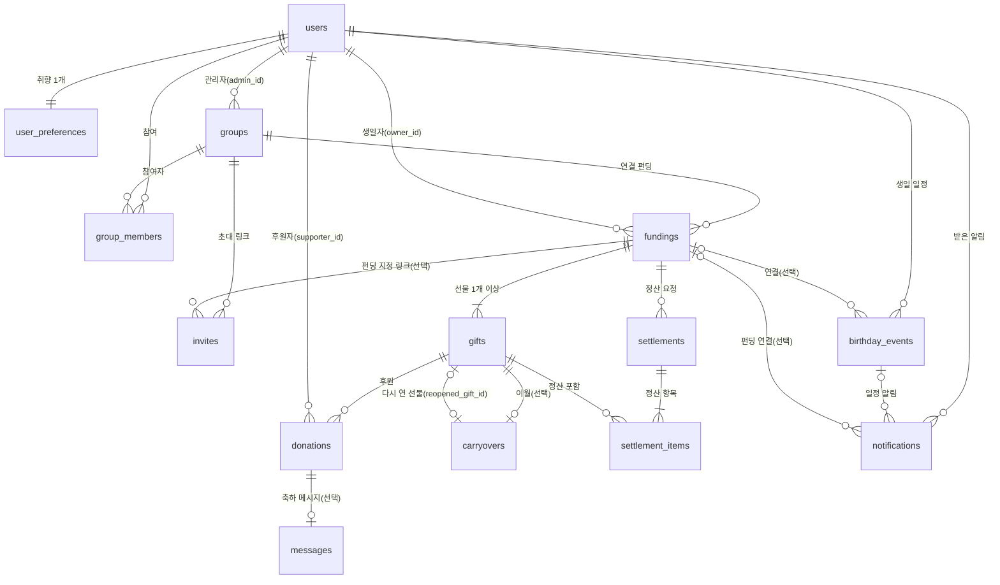

# DATA_MODEL.md — 프론트엔드 데이터 형식 정리

> 기준 코드: `frontend/src/types/index.ts`, `frontend/src/lib/mock/db.ts` 외 (2026-10-16 기준)
> 아래 코드 블록은 **실제 소스 코드에서 그대로 옮겨 온 원문**입니다. 코드가 바뀌면 이 문서도 함께 갱신해 주세요.
> 1~5장은 현재 코드 정리, **6장은 백엔드 연동을 위한 데이터 설계(S1)**입니다.

---

## 0. 읽는 법

TypeScript 에서 데이터의 "모양"을 정하는 방법은 두 가지이고, 이 프로젝트는 둘 다 사용합니다.

| 문법 | 의미 | 예 |
|---|---|---|
| `export interface 이름 { ... }` | **객체(묶음 데이터)**의 필드와 타입을 정의 | `export interface User { id: Id; name: string; ... }` |
| `export type 이름 = ...` | **별칭** 또는 정해진 값 중 하나(유니온) | `export type FundingStatus = "scheduled" \| "active" \| "ended";` |
| `interface A extends B` | B 의 필드를 모두 가지고 + 필드 추가 | `OwnerGiftView extends SupporterGiftView` |

- `필드?:` 는 없어도 되는 값, `| null` 은 값이 비어 있을 수 있음을 뜻합니다.
- `Id` = `string` (예: `"u_seoyeon"`, `"f_my24"`) · 금액은 원 단위 정수 · 날짜 `"YYYY-MM-DD"` · 시각은 ISO 문자열
- 데이터는 세 층으로 나뉩니다.
  1. **저장 데이터** (`lib/mock/db.ts`, `Db~`) — 나중에 DB 테이블이 되는 원본
  2. **화면이 받는 데이터** (`types/index.ts`) — API 응답 형식. 권한에 따라 가공됨
  3. **화면이 보내는 데이터** (`~Input`, `~Request`) — API 요청 형식

---

## 1. 저장 데이터 — `lib/mock/db.ts`

브라우저 localStorage 의 `gift-funding:mock-db` 키 하나에 `MockDatabase` 전체가 JSON 으로 저장됩니다.
선물의 **모금액은 저장하지 않고** `DbDonation.amount` 합계로 계산합니다.

| interface | 의미 | 나중에 될 DB 테이블 |
|---|---|---|
| DbUser | 회원 (+ 선물 취향) | users, user_preferences |
| DbGroup | 그룹 (관리자 · 참여자 목록) | groups, group_members |
| DbInvite | 초대 링크 | invites |
| DbFunding | 생일 펀딩 | fundings |
| DbGift | 선물 (가격 = 목표 금액, 미달 처리 · 정산 상태) | gifts |
| DbDonation | 후원 1건 (중복 방지 키 포함) | donations |
| DbMessage | 축하 메시지 (후원에 연결) | messages |
| DbCarryover | 다음 생일로 이월한 금액 | carryovers |
| DbSettlement | 정산 요청 | settlements |
| DbBirthdayEvent | 내가 등록한 친구 생일 | birthday_events |
| DbNotification | 알림 (중복 생성 방지 키 포함) | notifications |

```ts
export interface DbUser {
  id: string;
  name: string;
  email: string;
  passwordHash: string; // 모의 해시 (실제 서버에서는 Argon2 사용)
  birthday: string;
  profileImage: string | null;
  preference: { keywords: string[]; categories: string[]; priceRange: PriceRangeKey | null };
}

export interface DbGroup {
  id: string;
  name: string;
  description: string;
  adminId: string;
  memberIds: string[];
  createdAt: string;
}

export interface DbInvite {
  token: string;
  groupId: string;
  fundingId: string | null;
  isActive: boolean;
  createdAt: string;
}

export interface DbFunding {
  id: string;
  ownerId: string;
  groupId: string;
  name: string;
  startDate: string;
  endDate: string;
  createdAt: string;
}

export interface DbGift {
  id: string;
  fundingId: string;
  name: string;
  price: number;
  imageUrl: string;
  productUrl: string;
  description: string;
  shortfallAction: ShortfallAction | null;
  settlementId: string | null;
}

export interface DbDonation {
  id: string;
  fundingId: string;
  giftId: string;
  supporterId: string;
  amount: number;
  idempotencyKey: string;
  createdAt: string;
}

export interface DbMessage {
  id: string;
  donationId: string;
  fundingId: string;
  giftId: string;
  authorId: string;
  content: string;
  createdAt: string;
}

export interface DbCarryover {
  id: string;
  ownerId: string;
  fundingId: string;
  giftId: string;
  amount: number;
  createdAt: string;
}

export interface DbSettlement {
  id: string;
  ownerId: string;
  fundingId: string;
  giftIds: string[];
  amount: number;
  bank: string;
  accountNumber: string;
  accountHolder: string;
  status: SettlementStatus;
  requestedAt: string;
}

export interface DbBirthdayEvent {
  id: string;
  ownerId: string;
  friendName: string;
  birthday: string;
  linkedFundingId: string | null;
}

export interface DbNotification {
  id: string;
  userId: string;
  type: NotificationType;
  title: string;
  body: string;
  eventId: string;
  fundingId: string | null;
  dedupeKey: string; // 같은 일정 · 같은 날짜 · 같은 유형 알림 중복 생성 방지
  isRead: boolean;
  createdAt: string;
}

export interface MockDatabase {
  version: number;
  users: DbUser[];
  groups: DbGroup[];
  invites: DbInvite[];
  fundings: DbFunding[];
  gifts: DbGift[];
  donations: DbDonation[];
  messages: DbMessage[];
  carryovers: DbCarryover[];
  settlements: DbSettlement[];
  birthdayEvents: DbBirthdayEvent[];
  notifications: DbNotification[];
}
```

---

## 2. 화면이 받는 데이터 — `types/index.ts`

### 2.1 회원 · 취향

```ts
export type Id = string;

export interface User {
  id: Id;
  name: string; // 회원가입 시 등록한 실명 (축하 메시지 작성자 이름으로 사용)
  email: string;
  birthday: string; // YYYY-MM-DD
  profileImage: string | null; // data URL 또는 null
}

export interface GiftPreference {
  keywords: string[];
  categories: string[];
  priceRange: PriceRangeKey | null;
}

export type PriceRangeKey = "under30k" | "30k-100k" | "100k-300k" | "300k-500k" | "over500k";
```

### 2.2 그룹 · 초대

| 이름 | 사용 화면 |
|---|---|
| GroupSummary | 그룹 목록(UI-06) |
| GroupDetail | 그룹 상세(UI-15) |
| InviteLink | 초대 링크 관리(UI-16) |
| InvitePreview | 초대 확인 · 참여(UI-17) — 참여 전에 보여줄 정보 |

```ts
export interface GroupSummary {
  id: Id;
  name: string;
  description: string;
  memberCount: number;
  isAdmin: boolean; // 현재 사용자가 그룹 관리자인지
  fundings: GroupFundingSummary[]; // 접근 가능한 연결 펀딩
}

export interface GroupFundingSummary {
  id: Id;
  name: string;
  ownerName: string;
  isMine: boolean;
  status: FundingStatus;
}

export interface GroupDetail extends GroupSummary {
  members: { id: Id; name: string; isAdmin: boolean }[];
}

export interface InviteLink {
  token: string;
  groupId: Id;
  groupName: string;
  fundingId: Id | null; // 특정 펀딩으로 바로 연결되는 초대인 경우
  fundingName: string | null;
  isActive: boolean;
  createdAt: string;
}

export interface InvitePreview {
  token: string;
  groupName: string;
  fundingName: string | null;
  ownerName: string | null; // 생일자 이름
  alreadyJoined: boolean;
  targetFundingId: Id | null; // 참여 후 이동할 펀딩
}
```

### 2.3 펀딩 · 선물 (권한별로 분리)

| 이름 | 누구에게 | 모금액 · 남은 금액 |
|---|---|---|
| SupporterGiftView / FriendFundingView | 후원자(친구 펀딩) | **필드 자체가 없음** (비공개 정책을 타입으로 보장) |
| OwnerGiftView / OwnerFundingView | 생일자(내 펀딩) | 있음 (`raisedAmount`, `remainingAmount`, `totalRaised`) |

```ts
export type FundingStatus = "scheduled" | "active" | "ended"; // 예정 / 진행 중 / 종료

export interface SupporterGiftView {
  id: Id;
  name: string;
  price: number; // 실제 가격 = 목표 금액
  imageUrl: string;
  productUrl: string;
  description: string;
  achievementRate: number; // 0~100 정수
  isClosed: boolean; // 목표 달성(100%)으로 후원 마감
}

export interface OwnerGiftView extends SupporterGiftView {
  raisedAmount: number; // 현재 전체 모금액
  remainingAmount: number; // 남은 모금액
  donationCount: number;
  shortfallAction: ShortfallAction | null; // 목표 미달 처리 결과
  settled: boolean; // 정산 요청에 포함되었는지
}

export interface FundingBase {
  id: Id;
  name: string;
  groupId: Id;
  groupName: string;
  ownerName: string;
  startDate: string; // YYYY-MM-DD
  endDate: string; // YYYY-MM-DD
  status: FundingStatus;
}

export interface OwnerFundingView extends FundingBase {
  gifts: OwnerGiftView[];
  totalRaised: number;
}

export interface FriendFundingView extends FundingBase {
  gifts: SupporterGiftView[];
}
```

### 2.4 후원 · 메시지

| 이름 | 사용 화면 |
|---|---|
| MyDonation | 후원 완료(UI-20) · 내 후원 내역(UI-21) — 본인 것만 |
| SupporterDonation | 후원자 내역(UI-13) — 생일자 전용 |
| ReceivedMessage | 축하 편지함(UI-27) — 금액 없음 |

```ts
export interface MyDonation {
  id: Id;
  fundingId: Id;
  fundingName: string;
  ownerName: string;
  giftId: Id;
  giftName: string;
  amount: number;
  hasMessage: boolean;
  createdAt: string;
  status: "completed";
}

export interface SupporterDonation {
  id: Id;
  supporterName: string;
  giftId: Id;
  giftName: string;
  amount: number;
  createdAt: string;
}

export interface ReceivedMessage {
  id: Id;
  authorName: string;
  content: string;
  fundingName: string;
  giftName: string;
  createdAt: string;
}
```

### 2.5 목표 미달 · 정산

```ts
export type ShortfallAction = "carryover" | "withdraw"; // 다음 생일로 이월 / 현재 모금액 인출

export type SettlementStatus = "requested" | "processing" | "completed" | "failed";

export interface SettlementRecord {
  id: Id;
  fundingId: Id;
  giftNames: string[];
  amount: number;
  bank: string;
  accountNumberMasked: string;
  accountHolder: string;
  status: SettlementStatus;
  requestedAt: string;
}

export interface SettlementOverview {
  fundingId: Id;
  fundingName: string;
  eligibleGifts: { id: Id; name: string; amount: number; reason: "achieved" | "withdraw" }[];
  eligibleAmount: number;
  carryoverGifts: { id: Id; name: string; amount: number }[];
  history: SettlementRecord[];
}
```

### 2.6 생일 캘린더 · 알림 · AI 추천

```ts
export interface BirthdayEvent {
  id: Id;
  friendName: string;
  birthday: string; // YYYY-MM-DD (연도는 태어난 해, 매년 반복 표시)
  linkedFundingId: Id | null;
  linkedFundingName: string | null;
  canOpenLinkedFunding: boolean; // 연결 펀딩 열람 권한
  linkedFundingIsMine: boolean;
}

export type NotificationType = "birthday-before" | "birthday-today";

export interface AppNotification {
  id: Id;
  type: NotificationType;
  title: string;
  body: string;
  createdAt: string;
  isRead: boolean;
  /** 클릭 시 이동할 경로 (권한이 없는 펀딩은 캘린더로 대체) */
  href: string;
}

export interface AiRecommendation {
  id: Id;
  name: string;
  reason: string;
  category: string;
  priceMin: number;
  priceMax: number;
}
```

---

## 3. 화면이 보내는 데이터 (요청 형식)

| 이름 | 위치 | 사용 |
|---|---|---|
| SignupInput · ProfileInput | `lib/api/auth.ts` | 회원가입 · 프로필 수정 |
| GiftInput · FundingInput | `types/index.ts` | 선물 등록 · 펀딩 생성 (선물 최소 1개) |
| DonationRequest | `types/index.ts` | 후원 (`message` 가 빈 문자열이면 메시지 없음) |
| SettlementRequest | `types/index.ts` | 정산 신청 |
| BirthdayEventInput | `types/index.ts` | 생일 일정 등록 · 수정 |
| AiRecommendationRequest | `types/index.ts` | AI 추천 요청 |
| FundingDraft | `lib/fundingDraft.ts` | 펀딩 만드는 중 임시 저장 (sessionStorage) |

```ts
export interface SignupInput {
  name: string;
  email: string;
  password: string;
  passwordConfirm: string;
  birthday: string;
}

export interface ProfileInput {
  name: string;
  birthday: string;
  profileImage: string | null;
}
```

```ts
export interface GiftInput {
  name: string;
  price: number;
  imageUrl: string;
  productUrl: string;
  description: string;
}

export interface FundingInput {
  name: string;
  groupId: Id;
  startDate: string;
  endDate: string;
  gifts: GiftInput[];
}

export interface DonationRequest {
  giftId: Id;
  amount: number;
  message: string; // 빈 문자열이면 메시지 없음
  idempotencyKey: string; // 동일 요청 중복 처리 방지용 식별자
}

export interface SettlementRequest {
  giftIds: Id[];
  bank: string;
  accountNumber: string;
  accountHolder: string;
}

export interface BirthdayEventInput {
  friendName: string;
  birthday: string;
  linkedFundingId: Id | null;
}

export interface AiRecommendationRequest {
  keywords: string[];
  categories: string[];
  budgetMin: number | null;
  budgetMax: number | null;
}
```

```ts
export interface FundingDraft {
  name: string;
  groupId: string;
  startDate: string;
  endDate: string;
  gifts: GiftInput[];
}
```

---

## 4. 오류 형식 — `lib/api/client.ts`

API 가 실패하면 `ApiError` (class) 를 던집니다: `{ code, message, fieldErrors?, maxAvailable? }`
- `fieldErrors`: 입력 칸별 오류 문구 (예: `{ email: "이미 사용 중인 이메일입니다." }`)
- `maxAvailable`: 초과 후원일 때 최대 후원 가능 금액

```ts
export type ApiErrorCode =
  | "UNAUTHORIZED" // 로그인 필요 / 인증 만료
  | "FORBIDDEN" // 접근 권한 없음
  | "NOT_FOUND"
  | "VALIDATION" // 입력값 오류
  | "DUPLICATE_EMAIL"
  | "INVALID_CREDENTIALS"
  | "INVITE_INVALID" // 존재하지 않는 초대 링크
  | "INVITE_INACTIVE" // 비활성화된 초대 링크
  | "EXCEEDS_REMAINING" // 남은 모금액 초과 → details.maxAvailable 제공
  | "GOAL_REACHED" // 목표 달성으로 후원 마감
  | "FUNDING_NOT_ACTIVE" // 종료되었거나 시작 전인 펀딩
  | "GIFT_LOCKED" // 후원이 발생한 선물 수정/삭제 제한
  | "CONFLICT" // 이미 처리된 요청 (이월·인출·정산 중복 등)
  | "NETWORK";
```

---

## 5. 데이터가 아닌 interface (참고)

- `~Props` 로 끝나는 18개 (예: `ButtonProps`, `GiftFormProps`) — 화면 부품에 넘기는 옵션
- `AuthContextValue` (로그인 상태 공유), `AsyncState` · `Result` (로딩 · 오류 상태), `Candidate` (AI 모의 추천 후보), `FieldControlProps` (입력칸 접근성 속성)

---

## 6. 백엔드 연동 설계 (S1 · 데이터 설계)

> 작성일: 2026-10-16 · 상태: **검토 대기 (코드 변경 없음)**
> 근거: `docs/product/FEATURE_SPEC.md`(F-01~F-16), `docs/design/pages/*.md`(UI-01~UI-29), 현재 코드(`lib/mock/db.ts`, `types/index.ts`, `lib/api/*`)
> 범위: 사용자 관리 · 그룹 · 초대 · 펀딩 · 선물 · 후원 · 메시지 · 정산 · 캘린더 · 알림.
> **그룹 삭제 기능은 제공하지 않는다** (plan.md 7.1 D8). 참여자 제외 · 그룹 나가기 기능도 이번 범위에 없다.

### 6.0 표기 · 공통 규칙

| 항목 | 규칙 |
|---|---|
| 이름 표기 | DB 컬럼 · API JSON은 `snake_case`, 프론트 타입은 `camelCase`. 변환은 `lib/api` 매퍼에서만 한다. |
| ID | 서버가 만든 문자열(UUID 권장). 프론트는 `Id = string`으로만 다루고 형식에 의존하지 않는다. |
| 금액 | 원 단위 정수(`INTEGER`). 소수점 없음. |
| 날짜 | 생일 · 펀딩 기간은 `DATE`(`YYYY-MM-DD`), 생성 · 수정 시각은 `TIMESTAMPTZ`(ISO 문자열). |
| 기준 시간대 | 펀딩 상태(예정/진행/종료)와 알림 날짜는 **서버가 Asia/Seoul 날짜 기준으로 계산**한다. |
| 삭제 | Hard Delete. `deleted_at` 같은 Soft Delete 컬럼은 두지 않는다. |
| 계산 값 | 모금액 · 남은 금액 · 달성률 · 상태는 **DB에 저장하지 않고** 조회할 때 서버가 계산한다 (6.6). |

표의 "구분" 표기
- **유지**: 현재 Mock DB에 이미 있는 필드
- **신규**: 기능 · 화면명세서를 충족하려면 추가해야 하는 필드
- **변경**: 저장 위치나 형태를 바꾸는 필드 (예: 배열 → 별도 테이블)

---

### 6.1 기능 · 화면별 추가 필요 필드

현재 코드와 명세서를 비교해 빠졌거나 형태를 바꿔야 하는 필드만 모았다.
"반영 시점"은 **지금**(Mock 단계 S4~S8에서 반영), **연동 시**(실제 백엔드 구현 때 반영), **미정**(정책 결정 후)으로 나눈다.

| 도메인 | 필드 | 필요한 이유 (근거) | 현재 상태 | 반영 시점 |
|---|---|---|---|---|
| 사용자 | `users.created_at`, `updated_at` | 가입 · 수정 이력 관리 (공통) | 없음 | 연동 시 |
| 사용자 | `users.profile_image_url` | 프로필 사진 (F-02, UI-25). 지금은 data URL을 그대로 저장 | `profileImage`(data URL) | 연동 시 (업로드 API로 교체) |
| 사용자 | 로그인 요청 `remember_me` | "로그인 상태 유지" 체크박스 (UI-03 3.3) | 화면에만 있음, 저장 방식만 다름 | 연동 시 |
| 사용자 | 인증 응답 `access_token`, `token_type`, `expires_in` | 인증 만료 시 재로그인 안내 (F-01 예외 처리) | Mock 토큰 문자열 | 연동 시 |
| 취향 | `user_preferences` 테이블 분리 + `updated_at` | 취향은 계정별 저장, AI 추천 기본값 (F-02, F-03) | `DbUser.preference`에 포함 | 연동 시 (변경) |
| 그룹 | `group_members` 테이블 + `joined_at` | 중복 가입 방지(UNIQUE), 참여자 목록 정렬 (F-05, UI-15) | `DbGroup.memberIds` 배열 | 연동 시 (변경) |
| 그룹 | `groups.updated_at` | 수정 이력 | 없음 | 연동 시 |
| 초대 | `invites.id` (PK) | 토큰과 식별자 분리 (토큰은 비밀 값) | 토큰이 식별자 | 연동 시 |
| 초대 | `invites.created_by` | 펀딩 생일자가 만든 링크 관리 권한 확인 (F-06 "그룹 또는 펀딩 관리 권한") | 없음 (조건으로 추론) | 연동 시 |
| 초대 | `invites.deactivated_at` | 비활성화 시점 기록 (UI-16) | 없음 | 연동 시 |
| 초대 | 만료 판정 (저장 X, 계산) | **펀딩 지정 링크는 그 펀딩이 끝나면 만료** (6.9 D-S1-4, F-06 예외 처리) | 만료 없음 | 지금 (`INVITE_EXPIRED` 오류 추가) |
| 펀딩 | `fundings.updated_at` | 수정 이력 | 없음 | 연동 시 |
| 선물 | `gifts.sort_order` | 등록 순서대로 표시 (UI-12, UI-18) | 배열 순서에 의존 | 연동 시 |
| 선물 | `gifts.created_at`, `updated_at` | 등록 · 수정 이력 (F-04) | 없음 | 연동 시 |
| 선물 | `gifts.shortfall_decided_at` | 목표 미달 처리 시점 기록 (F-11 "처리 상태 관리") | 없음 | 연동 시 |
| 선물 | `gifts.settlement_id` → `settlement_items` | 선물별 중복 정산 방지를 DB 제약으로 보장 (F-12) | `DbGift.settlementId` + `DbSettlement.giftIds` 배열 | 연동 시 (변경) |
| 후원 | `donations.status` | 내 후원 내역의 "처리 상태" (UI-21) | 응답에 `"completed"` 고정 | 연동 시 (실결제 도입 시 값 확장) |
| 메시지 | `messages`의 `funding_id`, `gift_id`, `author_id` 제거 | 후원(`donation_id`)으로 모두 알 수 있음 → 중복 저장 제거 | 중복 저장 중 | 연동 시 (변경) |
| 이월 | `carryovers.status`, `reopened_funding_id`, `reopened_gift_id`, `reopened_at` | **이월한 선물은 다음 생일에 펀딩을 다시 연다** (6.9 D-S1-3, F-11) | 없음 | 연동 시 (다시 열기 화면은 추가 구현) |
| 정산 | `settlements.processed_at`, `failure_reason` | 정산 처리 상태 · 실패 안내 (F-12, UI-24) | 없음 | 연동 시 |
| 정산 | `settlements.account_number` 암호화 저장 | 계좌번호 보호, 응답은 마스킹 (UI-24) | 원문 저장, 응답만 마스킹 | 연동 시 |
| 캘린더 | `birthday_events.created_at`, `updated_at` | 등록 · 수정 이력 (F-15) | 없음 | 연동 시 |
| 알림 | `notifications.funding_id` | **펀딩 삭제 시 연결 알림 삭제** (plan.md D7) | **이미 있음** | 지금 (삭제 로직만 추가) |
| 알림 | `notifications.read_at` | 읽음 처리 시점 (F-16) | 없음 | 연동 시 |
| 알림 | 응답의 `href` → `target`(이동 대상 정보) | 화면 경로는 프론트가 정한다. 서버는 `event_id`, `funding_id`, 열람 가능 여부만 준다 | 서버(Mock)가 경로 문자열을 만듦 | ✅ 반영 (S4, `lib/api/mappers.ts`) |

**추가가 필요 없는 항목 (확인 완료)**
- 홈 친구 펀딩 카드의 **선물별 달성률**(plan.md D5): `FriendFundingView.gifts[].achievementRate`로 이미 제공되고, 카드도 선물별로 표시 중이다.
- 내 펀딩 목록의 모금액 · 달성률(UI-05), 후원자 내역(UI-13), 편지함 필터(UI-27): 현재 필드로 충분하다.
- 그룹 삭제 관련 필드: 기능을 제공하지 않으므로 없다.

---

### 6.2 도메인별 데이터 구조 (DB 테이블 설계)

#### 6.2.1 사용자 관리

**users** — 회원 (F-01, F-02)

| 컬럼 | 타입 | 제약 · 기본값 | 구분 | 비고 |
|---|---|---|---|---|
| id | UUID | PK | 유지 | |
| name | VARCHAR(50) | NOT NULL | 유지 | 실명. 축하 메시지 작성자 이름으로 사용 (F-14) · 최대 50자 (2026-10-19 확정) |
| email | VARCHAR(255) | NOT NULL, UNIQUE | 유지 | 소문자로 정규화해 저장 |
| password_hash | TEXT | NOT NULL | 유지 | Argon2. 원문 · 확인값은 저장하지 않음 |
| birthday | DATE | NOT NULL | 유지 | |
| profile_image_url | TEXT | NULL | 변경 | 지금은 data URL |
| created_at | TIMESTAMPTZ | NOT NULL, now() | 신규 | |
| updated_at | TIMESTAMPTZ | NOT NULL, now() | 신규 | |

**user_preferences** — 선물 취향 (F-02, F-03, UI-26)

| 컬럼 | 타입 | 제약 · 기본값 | 구분 | 비고 |
|---|---|---|---|---|
| user_id | UUID | PK, FK → users.id | 변경 | 사용자당 1행 |
| keywords | TEXT[] | NOT NULL, 기본 `{}` | 유지 | 최대 10개 (서버 검증) |
| categories | TEXT[] | NOT NULL, 기본 `{}` | 유지 | 정해진 카테고리 값만 허용 |
| price_range | VARCHAR(20) | NULL, CHECK(`under30k` · `30k-100k` · `100k-300k` · `300k-500k` · `over500k`) | 유지 | |
| updated_at | TIMESTAMPTZ | NOT NULL, now() | 신규 | |

#### 6.2.2 그룹 · 초대

**groups** — 비공개 그룹 (F-05)

| 컬럼 | 타입 | 제약 · 기본값 | 구분 | 비고 |
|---|---|---|---|---|
| id | UUID | PK | 유지 | |
| name | VARCHAR(30) | NOT NULL | 유지 | 펀딩 이름과 별도 · 최대 30자 (확정) |
| description | VARCHAR(100) | NOT NULL, 기본 `''` | 유지 | 선택 입력 · 최대 100자 (확정) |
| admin_id | UUID | NOT NULL, FK → users.id | 유지 | 그룹 생성자 = 관리자 |
| created_at | TIMESTAMPTZ | NOT NULL | 유지 | |
| updated_at | TIMESTAMPTZ | NOT NULL | 신규 | |

> 그룹 삭제 API는 만들지 않는다. 그래서 `groups`를 지우는 경로가 없다.

**group_members** — 그룹 참여자 (F-05, F-06)

| 컬럼 | 타입 | 제약 · 기본값 | 구분 | 비고 |
|---|---|---|---|---|
| group_id | UUID | PK(1), FK → groups.id | 변경 | |
| user_id | UUID | PK(2), FK → users.id | 변경 | (group_id, user_id) 복합 PK → **중복 가입 방지** |
| joined_at | TIMESTAMPTZ | NOT NULL, now() | 신규 | 참여자 목록 정렬 |

> 관리자도 `group_members`에 한 행으로 들어간다. 관리자 여부는 `groups.admin_id`로 판단한다.

**invites** — 초대 링크 (F-06, UI-16, UI-17)

| 컬럼 | 타입 | 제약 · 기본값 | 구분 | 비고 |
|---|---|---|---|---|
| id | UUID | PK | 신규 | |
| token | VARCHAR(64) | NOT NULL, UNIQUE | 유지 | Python `secrets`로 생성. 예측 불가 |
| group_id | UUID | NOT NULL, FK → groups.id | 유지 | |
| funding_id | UUID | NULL, FK → fundings.id **ON DELETE CASCADE** | 유지 | 지정 시 참여 후 해당 펀딩으로 이동 |
| created_by | UUID | NOT NULL, FK → users.id | 신규 | 관리자 또는 펀딩 생일자 |
| is_active | BOOLEAN | NOT NULL, 기본 true | 유지 | |
| created_at | TIMESTAMPTZ | NOT NULL | 유지 | |
| deactivated_at | TIMESTAMPTZ | NULL | 신규 | |
| (만료) | — | 저장하지 않음 | 계산 | `funding_id`가 있고 그 펀딩이 `ended`면 만료. 그룹 링크(`funding_id` 없음)는 비활성화 전까지 유효 |

#### 6.2.3 펀딩 · 선물

**fundings** — 생일 펀딩 (F-07)

| 컬럼 | 타입 | 제약 · 기본값 | 구분 | 비고 |
|---|---|---|---|---|
| id | UUID | PK | 유지 | |
| owner_id | UUID | NOT NULL, FK → users.id | 유지 | 펀딩을 만든 사람 = 생일자 |
| group_id | UUID | NOT NULL, FK → groups.id | 유지 | 📌 생일자가 만든 그룹만 (2026-10-19 확정) |
| name | VARCHAR(40) | NOT NULL | 유지 | 그룹 이름과 별도 · 최대 40자 (확정) |
| start_date | DATE | NOT NULL | 유지 | |
| end_date | DATE | NOT NULL, CHECK(end_date >= start_date AND end_date <= start_date + 20) | 유지 | 시작일 포함 최대 21일 (2026-10-19). 시작일 ≥ 오늘은 서버 검증 |
| created_at | TIMESTAMPTZ | NOT NULL | 유지 | |
| updated_at | TIMESTAMPTZ | NOT NULL | 신규 | |

> 상태(`scheduled` · `active` · `ended`)는 저장하지 않고 날짜로 계산한다 (6.6).

**gifts** — 펀딩 선물 (F-04, F-09, F-11)

| 컬럼 | 타입 | 제약 · 기본값 | 구분 | 비고 |
|---|---|---|---|---|
| id | UUID | PK | 유지 | |
| funding_id | UUID | NOT NULL, FK → fundings.id **ON DELETE CASCADE** | 유지 | |
| name | VARCHAR(100) | NOT NULL | 유지 | 최대 100자 (확정) |
| price | INTEGER | NOT NULL, CHECK(price > 0) | 유지 | 실제 가격 = 목표 금액 |
| image_url | TEXT | NOT NULL | 유지 | 지금은 data URL |
| product_url | TEXT | NOT NULL | 유지 | URL 형식 검증 |
| description | VARCHAR(100) | NOT NULL, 기본 `''` | 유지 | 선택 입력 · 최대 100자 (확정) |
| sort_order | INTEGER | NOT NULL | 신규 | 등록 순서 |
| shortfall_action | VARCHAR(10) | NULL, CHECK(`carryover` · `withdraw`) | 유지 | 목표 미달 처리 결과. 한 번 정하면 변경 불가 |
| shortfall_decided_at | TIMESTAMPTZ | NULL | 신규 | |
| created_at / updated_at | TIMESTAMPTZ | NOT NULL | 신규 | |

> `settlement_id`는 `settlement_items`로 옮긴다 (6.2.5).

#### 6.2.4 후원 · 축하 메시지

**donations** — 후원 (F-08, F-10)

| 컬럼 | 타입 | 제약 · 기본값 | 구분 | 비고 |
|---|---|---|---|---|
| id | UUID | PK | 유지 | |
| funding_id | UUID | NOT NULL, FK → fundings.id **ON DELETE RESTRICT** | 유지 | 조회 편의용. `gifts.funding_id`와 같아야 함 |
| gift_id | UUID | NOT NULL, FK → gifts.id **ON DELETE RESTRICT** | 유지 | 후원이 있는 선물 · 펀딩은 삭제 불가 |
| supporter_id | UUID | NOT NULL, FK → users.id | 유지 | |
| amount | INTEGER | NOT NULL, CHECK(amount > 0) | 유지 | |
| idempotency_key | VARCHAR(64) | NOT NULL | 유지 | (supporter_id, idempotency_key) **UNIQUE** → 같은 요청 중복 처리 방지 |
| status | VARCHAR(20) | NOT NULL, 기본 `completed` | 신규 | 현재 값은 `completed` 하나 (모의 후원) |
| created_at | TIMESTAMPTZ | NOT NULL | 유지 | |

> 동시 후원: 서버는 선물 행을 잠그고(`SELECT … FOR UPDATE`) 최신 합계로 남은 금액을 다시 계산한 뒤 저장한다 (F-10).

**messages** — 축하 메시지 (F-14)

| 컬럼 | 타입 | 제약 · 기본값 | 구분 | 비고 |
|---|---|---|---|---|
| id | UUID | PK | 유지 | |
| donation_id | UUID | NOT NULL, **UNIQUE**, FK → donations.id | 유지 | 후원 1건당 메시지 최대 1개 |
| content | VARCHAR(200) | NOT NULL | 유지 | 빈 메시지는 행을 만들지 않음 · 최대 200자 (확정) |
| created_at | TIMESTAMPTZ | NOT NULL | 유지 | |

> 작성자 · 펀딩 · 선물은 `donations`를 통해 조회한다. 작성자 이름은 항상 `users.name`(실명)이다.
> 후원과 메시지는 **같은 트랜잭션**으로 저장한다.

#### 6.2.5 목표 미달 · 정산

**carryovers** — 다음 생일로 이월 (F-11)

| 컬럼 | 타입 | 제약 · 기본값 | 구분 | 비고 |
|---|---|---|---|---|
| id | UUID | PK | 유지 | |
| owner_id | UUID | NOT NULL, FK → users.id | 유지 | |
| funding_id | UUID | NOT NULL, FK → fundings.id | 유지 | |
| gift_id | UUID | NOT NULL, **UNIQUE**, FK → gifts.id | 유지 | 같은 선물 이월 중복 방지 |
| amount | INTEGER | NOT NULL, CHECK(amount > 0) | 유지 | |
| status | VARCHAR(20) | NOT NULL, CHECK(`pending` · `reopened`), 기본 `pending` | 신규 | `pending`: 다음 생일 대기 / `reopened`: 다시 연 펀딩에 반영됨 |
| reopened_funding_id | UUID | NULL, FK → fundings.id | 신규 | 다음 생일에 다시 연 펀딩 |
| reopened_gift_id | UUID | NULL, **UNIQUE**, FK → gifts.id | 신규 | 이월 금액이 시작 모금액으로 들어간 선물 |
| reopened_at | TIMESTAMPTZ | NULL | 신규 | |
| created_at | TIMESTAMPTZ | NOT NULL | 유지 | |

> CHECK: `pending`이면 `reopened_*` 모두 NULL, `reopened`이면 모두 NOT NULL (2026-10-19)

**settlements** — 정산 요청 (F-12, UI-24)

| 컬럼 | 타입 | 제약 · 기본값 | 구분 | 비고 |
|---|---|---|---|---|
| id | UUID | PK | 유지 | |
| owner_id | UUID | NOT NULL, FK → users.id | 유지 | |
| funding_id | UUID | NOT NULL, FK → fundings.id | 유지 | |
| amount | INTEGER | NOT NULL, CHECK(amount > 0) | 유지 | 서버가 항목 합계로 계산 |
| bank | VARCHAR(30) | NOT NULL | 유지 | |
| account_number | TEXT | NOT NULL | 변경 | 암호화 저장, 응답은 마스킹 |
| account_holder | VARCHAR(50) | NOT NULL | 유지 | 계정 이름과 같아야 함 (본인 명의) |
| status | VARCHAR(20) | NOT NULL, CHECK(`requested` · `processing` · `completed` · `failed`) | 유지 | |
| requested_at | TIMESTAMPTZ | NOT NULL | 유지 | |
| processed_at | TIMESTAMPTZ | NULL | 신규 | |
| failure_reason | VARCHAR(30) | NULL, CHECK(`ACCOUNT_INVALID` · `BANK_ERROR`) | 신규 | 실패 시 이유. 화면에 "계좌 정보 오류" / "은행 오류" 안내 후 재요청 (Q11-1) |

**settlement_items** — 정산에 포함된 선물 (신규)

| 컬럼 | 타입 | 제약 · 기본값 | 구분 | 비고 |
|---|---|---|---|---|
| settlement_id | UUID | PK(1), FK → settlements.id | 신규 | |
| gift_id | UUID | PK(2), FK → gifts.id | 신규 | |
| amount | INTEGER | NOT NULL | 신규 | 요청 시점의 선물 모금액 |
| reason | VARCHAR(10) | NOT NULL, CHECK(`achieved` · `withdraw`) | 신규 | 목표 달성 / 미달 인출 |
| is_active | BOOLEAN | NOT NULL, 기본 true | 신규 | 정산이 `failed`가 되면 같은 트랜잭션에서 false (2026-10-19) |

> 중복 정산 방지: "실패(`failed`)가 아닌 정산에 같은 선물이 두 번 들어갈 수 없다"를 서버 검증 + 부분 UNIQUE 인덱스 `CREATE UNIQUE INDEX uq_settlement_items_active_gift ON settlement_items (gift_id) WHERE is_active`로 보장한다 (2026-10-19 확정).
> 이월(`carryover`)한 선물은 정산 대상에서 제외한다.

#### 6.2.6 생일 캘린더 · 알림

**birthday_events** — 친구 생일 일정 (F-15, UI-28)

| 컬럼 | 타입 | 제약 · 기본값 | 구분 | 비고 |
|---|---|---|---|---|
| id | UUID | PK | 유지 | |
| owner_id | UUID | NOT NULL, FK → users.id | 유지 | 본인 일정만 조회 · 수정 |
| friend_name | VARCHAR(20) | NOT NULL | 유지 | 최대 20자 (확정) |
| birthday | DATE | NOT NULL | 유지 | 매년 반복 표시 |
| linked_funding_id | UUID | NULL, FK → fundings.id **ON DELETE SET NULL** | 유지 | 펀딩 삭제 시 연결만 해제 |
| created_at / updated_at | TIMESTAMPTZ | NOT NULL | 신규 | |

**notifications** — 알림 (F-16, UI-29)

| 컬럼 | 타입 | 제약 · 기본값 | 구분 | 비고 |
|---|---|---|---|---|
| id | UUID | PK | 유지 | |
| user_id | UUID | NOT NULL, FK → users.id | 유지 | 받는 사람 |
| type | VARCHAR(20) | NOT NULL, CHECK(`birthday-before` · `birthday-today` · `shortfall-reminder`) | 변경 | 하루 전 / 당일 / 미달 처리 알림(종료 후 7일, Q12) |
| title | VARCHAR(100) | NOT NULL | 유지 | 권한 없는 펀딩의 비공개 정보는 넣지 않음 |
| body | TEXT | NOT NULL | 유지 | |
| event_id | UUID | NULL, FK → birthday_events.id **ON DELETE CASCADE** | 유지 | **생일 일정 삭제 시 알림도 삭제** |
| funding_id | UUID | NULL, FK → fundings.id **ON DELETE CASCADE** | 유지 | **`shortfall-reminder`만 채운다** → 펀딩 삭제 시 그 알림만 삭제. 생일 알림은 항상 NULL(일정의 현재 연결 펀딩으로 판단)이라 펀딩이 지워져도 남는다 (2026-10-19 확정) |
| dedupe_key | VARCHAR(100) | NOT NULL | 유지 | (user_id, dedupe_key) **UNIQUE** → 같은 일정 · 날짜 · 유형 중복 방지 |
| is_read | BOOLEAN | NOT NULL, 기본 false | 유지 | |
| read_at | TIMESTAMPTZ | NULL | 신규 | |
| created_at | TIMESTAMPTZ | NOT NULL | 유지 | |

> CHECK (2026-10-19): 생일 알림은 `event_id`만, 미달 처리 알림은 `funding_id`만 채운다 (`docs/backend/ERD.md` 3.6)

---

### 6.3 도메인 관계 (ERD)



| 관계 | 종류 | 설명 |
|---|---|---|
| 사용자 ↔ 그룹 | N : M (`group_members`) | 한 사람이 여러 그룹에 참여, 그룹에는 여러 참여자 |
| 그룹 → 펀딩 | 1 : N | 펀딩은 하나의 그룹에 연결. **펀딩 열람 권한 = 생일자 본인 또는 그 그룹 참여자** |
| 사용자 → 펀딩 | 1 : N | 펀딩을 만든 사람이 생일자. 같은 사람이 다른 펀딩에서는 후원자 |
| 펀딩 → 선물 | 1 : N (최소 1) | 선물별로 목표 금액 · 달성률 관리 (펀딩 전체 합산 없음) |
| 선물 → 후원 | 1 : N | 같은 사람이 같은 선물에 여러 번 후원 가능 (요청마다 새 멱등 키) |
| 후원 → 메시지 | 1 : 0..1 | 메시지는 선택. 생일자만 열람 |
| 선물 → 이월 / 정산 항목 | 1 : 0..1 | 같은 금액을 이월과 인출에 중복 사용할 수 없음 |
| 이월 → 다시 연 선물 | 0..1 : 0..1 | 다음 생일에 펀딩을 다시 열면 이월 금액이 새 선물의 시작 모금액이 된다 |
| 그룹 → 펀딩 열람 | — | **초대받아 참여한 그룹의 펀딩만** 열람 · 후원 가능 (6.9 D-S1-2) |
| 생일 일정 → 펀딩 | N : 0..1 | 연결은 선택. 권한 없는 펀딩은 연결돼도 열람 불가 |

---

### 6.4 삭제 · 연결 데이터 처리

모든 삭제는 Hard Delete이고, 화면에서는 공통 삭제 확인 모달을 거친다 (plan.md 7.5).

| 삭제 대상 | 삭제 가능 조건 | 함께 삭제 | 연결 해제 (NULL) | 남는 데이터 |
|---|---|---|---|---|
| **펀딩** | 생일자 본인 · **후원 0건** | 선물, 이 펀딩 지정 초대 링크, **이 펀딩의 미달 처리 알림** (생일 알림은 남음) | 생일 일정의 `linked_funding_id` | 없음 (후원 · 메시지 · 이월 · 정산은 후원 0건이라 존재하지 않음) |
| **선물** | 생일자 본인 · 그 선물의 후원 0건 · 펀딩에 선물이 2개 이상 | 없음 | 없음 | 펀딩 · 다른 선물 |
| 생일 일정 | 일정 등록자 본인 | **이 일정의 알림** | — | 연결된 펀딩 |
| 초대 링크 | 삭제 없음, 비활성화만 | — | — | 링크 기록 |
| 그룹 | **삭제 기능 없음** | — | — | — |
| 후원 · 메시지 · 정산 | 삭제 기능 없음 (기록 보호) | — | — | — |

- DB 안전장치: `donations.gift_id` · `donations.funding_id`는 `ON DELETE RESTRICT`. 서버 검증을 빠져나가도 후원이 있는 선물 · 펀딩은 지워지지 않는다.
- 펀딩 삭제는 하나의 트랜잭션으로 처리한다. 중간에 실패하면 아무것도 지워지지 않는다.
- ✅ Mock의 펀딩 삭제 · 생일 일정 삭제에 알림 함께 삭제를 반영했다 (S4, `lib/mock/handlers/fundings.ts` · `schedule.ts`).
- 이월(`pending`)이 남은 펀딩은 후원이 있으므로 원래 삭제할 수 없다. 다시 연 펀딩은 이월 금액이 들어가 있으므로 **후원이 0건이어도 삭제 불가**로 한다.

---

### 6.5 권한별 공개 필드 (F-13)

비공개 정보는 화면에서 숨기는 것이 아니라 **서버 응답에서 빼고**, 프론트 타입도 따로 둔다.

| 정보 | 생일자 응답 (`OwnerGiftView` · `OwnerFundingView`) | 후원자 응답 (`SupporterGiftView` · `FriendFundingView`) | 비고 |
|---|---|---|---|
| 선물 이름 · 이미지 · 가격(목표 금액) · 구매 URL · 설명 | ✅ | ✅ | |
| 달성률(%) · 후원 마감 여부 | ✅ | ✅ | |
| 현재 모금액 `raised_amount` · 남은 금액 `remaining_amount` | ✅ | ❌ 필드 없음 | 초과 후원 오류의 `max_available`만 예외 |
| 후원 건수 · 목표 미달 처리 결과 · 정산 여부 | ✅ | ❌ | |
| 펀딩 총 모금액 `total_raised` | ✅ | ❌ | |
| 후원자 이름 · 개별 금액 · 일시 (`SupporterDonation`) | ✅ 본인 펀딩만 | ❌ | |
| 본인 후원 내역 (`MyDonation`) | — | ✅ 본인 것만 | |
| 축하 메시지 (`ReceivedMessage`) | ✅ 본인 펀딩으로 온 것만 | ❌ | |
| 정산 정보 · 계좌 | ✅ 계좌번호는 마스킹 | ❌ 접근 불가 | |
| 그룹 참여자 목록 | 그룹 참여자 모두 | 그룹 참여자 모두 | 이름 · 관리자 여부만 (이메일 비공개) |
| 다른 사용자 정보 | 이름만 | 이름만 | 이메일 · 생일은 본인에게만 |

---

### 6.6 계산 값 (저장하지 않고 서버가 계산)

| 값 | 계산식 | 계산 위치 (지금 → 연동 후) |
|---|---|---|
| 선물 모금액 `raised_amount` | 그 선물의 `completed` 후원 금액 합계 **+ 이 선물로 다시 연 이월 금액** | `mock/access.ts raisedForGift` → 서버 |
| 남은 금액 `remaining_amount` | `price - raised_amount` (0 미만 없음) | Mock → 서버 |
| 달성률 `achievement_rate` | `floor(raised / price × 100)`, 최대 100 | Mock → 서버 |
| 후원 마감 `is_closed` | 달성률 100 | Mock → 서버 |
| 펀딩 상태 `status` | 오늘(Asia/Seoul) < 시작일 → `scheduled`, 종료일 이하 → `active`, 이후 → `ended` | `format.ts getFundingStatus`(Mock에서 사용) → 서버 |
| 펀딩 총 모금액 `total_raised` | 선물 모금액 합계 (생일자 전용) | Mock → 서버 |
| 정산 가능 금액 | 종료된 펀딩 중 달성 선물 + 인출 선택 선물, 이미 정산 · 이월된 선물 제외 | `settlements.ts` → 서버 |
| 선물 정산 상태 `settlement_status` | 그 선물이 들어간 (실패하지 않은) 정산의 상태, 없으면 null → 화면 "정산됨" · "정산 진행 중" 배지 (business-logic 7.3) | `mock/access.ts toOwnerGift` → 서버 |
| 초과 후원 시 `max_available` | 요청 시점 최신 `remaining_amount` | `donations.ts` → 서버 |
| 생일 D-day · 날짜 표시 형식 | 오늘과 다음 생일의 차이 | **프론트** (`format.ts`) — 화면 표시용 |

---

### 6.7 책임 구분 (백엔드 / 프론트엔드)

| 구분 | 백엔드 책임 | 프론트엔드 책임 |
|---|---|---|
| 인증 | 비밀번호 해시 · 확인, 토큰 발급 · 만료, 모든 API의 인증 확인 | 토큰 보관 · 전송, 만료 시 로그인 화면 이동, 초대 링크 복귀 경로 유지 |
| 권한 | 생일자 · 후원자 · 그룹 관리자 · 그룹 참여자 확인, 권한별 응답 필드 제외 | 권한별 타입 사용, 권한 없는 버튼 숨김 (보안 목적 아님) |
| 입력 검증 | **최종 검증** (필수 값, 금액 > 0, URL, 날짜, 메시지 200자, 키워드 10개, 계좌 명의) | 빠른 안내용 검증 (서버 결과를 대신하지 않음) |
| 금액 계산 | 모금액 · 남은 금액 · 달성률 · 정산 금액 계산 | 서버 값을 그대로 표시 (`formatWon` 등 표시 형식만) |
| 후원 처리 | 행 잠금 + 최신 합계 재계산, 초과 차단, 멱등 키 중복 방지, 후원 · 메시지 같은 트랜잭션 | 요청마다 새 멱등 키 생성, 버튼 중복 클릭 방지, 실패 시 입력 유지 |
| 저장 · 삭제 | 삭제 조건 검사, 연결 데이터 함께 삭제 · 해제 (6.4) | 삭제 확인 모달, 성공 후 관련 쿼리 갱신 · 화면 이동 |
| 정산 · 이월 | 중복 정산 · 이월 방지, 계좌 암호화 | 정산 대상 선택 UI, 마스킹된 계좌 표시 |
| 알림 | 생일 하루 전 · 당일 알림 생성(스케줄러), 중복 방지, 비공개 정보 제외 | 읽지 않은 알림 표시, 알림 대상 → 화면 경로 계산 |
| AI 추천 | OpenAI 호출, API 키 보관, 응답 형식 검증 | 조건 입력, 결과 표시, 선물 등록 화면으로 전달 |
| 표기 변환 | snake_case로 응답 | `lib/api` 매퍼에서 camelCase로 변환 |

현재 Mock에서 "백엔드 책임"을 대신하고 있는 코드
- `lib/mock/access.ts` (권한 · 모금액 계산), `lib/api/*.ts`의 `mockRequest` 안쪽 로직 (검증 · 저장 · 삭제)
- S4에서 이 로직을 `lib/mock/handlers/*`로 옮기고, `lib/api/*`에는 HTTP 호출과 매핑만 남긴다. 연동 후 Mock 폴더와 함께 삭제한다.

---

### 6.8 현재 구현 vs 추가 구현 (데이터 기준)

| 도메인 | 현재 구현됨 | 추가 필요 |
|---|---|---|
| 사용자 관리 | 회원 · 취향 저장, 프로필 수정, 이메일 중복 확인 | 테이블 분리(`user_preferences`), 이미지 URL, 토큰 만료 · 재발급 |
| 그룹 · 초대 | 그룹 생성 · 상세 · 초대 링크 생성 · 비활성화 · 참여 · 중복 참여 방지 · 그룹 단위 열람 권한 | `group_members` 분리, `invites.created_by` · `deactivated_at`, **펀딩 종료 시 초대 링크 만료**. **그룹 삭제는 코드에서 제거 (S6)** |
| 펀딩 · 선물 | 생성 · 조회 · 선물 추가/수정/삭제 · 펀딩 삭제 | 펀딩 삭제 시 미달 처리 알림 삭제(생일 알림 유지), `sort_order` · 수정 시각 |
| 후원 · 메시지 | 멱등 키, 초과 검증, 같은 처리 단위 저장, 편지함 필터 | `donations.status`, 메시지 중복 컬럼 정리, 서버 행 잠금 |
| 정산 · 이월 | 미달 처리, 정산 요청 · 이력, 계좌 명의 검증 | `settlement_items`, 처리 시각 · 실패 사유, 계좌 암호화, **이월 펀딩 다시 열기** (화면 · API · 모금액 계산) |
| 캘린더 · 알림 | 일정 CRUD, 펀딩 연결, 알림 생성 · 읽음 · 중복 방지 | 일정 삭제 시 알림 삭제, 응답 `href` → 이동 대상 정보, `read_at`, 서버 스케줄러 |

---

### 6.9 S1 검토 결정 사항 (2026-10-16 확정)

| # | 질문 | 결정 | 반영 위치 |
|---|---|---|---|
| D-S1-1 | 생일 일정 삭제 시 알림 | **함께 삭제** | 6.2.6 `notifications.event_id` CASCADE, 6.4 |
| D-S1-2 | 펀딩 열람 범위 (기능명세서 4.2) | **초대받아 참여한 그룹의 펀딩만** 열람 · 후원 가능. 그룹에 참여하지 않은 사람은 같은 링크 목록에 있어도 열람 불가 | 6.3, 현재 `canViewFunding` 규칙과 같음 |
| D-S1-3 | 이월 금액 사용 방식 | **이월한 선물은 다음 생일에 펀딩을 다시 연다** | 6.2.5 `carryovers`, 6.6 모금액 계산 |
| D-S1-4 | 초대 링크 만료 | **펀딩이 끝나면 만료** | 6.2.2 `invites`, 6.1 |

**D-S1-3 이월 펀딩 다시 열기 — 설계안**
1. 목표 미달 처리(UI-23)에서 "다음 생일로 이월"을 고르면 `carryovers`에 `pending`으로 기록한다 (현재와 같음).
2. 다음 생일 펀딩을 열 때 생일자가 이월 기록을 고르면, 서버가 **새 펀딩**을 만들고 이월된 선물을 같은 이름 · 가격 · 이미지 · URL로 복사한다.
3. 복사된 선물의 시작 모금액 = 이월 금액. 이후 후원은 남은 금액(`가격 - 이월 금액 - 새 후원`)까지만 받는다.
4. 이월 기록은 `reopened`로 바뀌고 `reopened_funding_id` · `reopened_gift_id`를 남긴다. 같은 이월 기록으로 두 번 열 수 없다.
5. 후원자에게는 달성률(%)만 보이므로 이월 금액도 달성률에만 반영된다 (모금액 비공개 원칙 유지).
6. 다시 연 펀딩이 끝나면 일반 펀딩과 같이 정산 또는 목표 미달 처리를 한다.

> 이 기능은 **추가 구현 필요**다. 지금 코드에는 이월 기록만 있고 다시 여는 화면 · API가 없다.
> 확정 (2026-10-16): ① **펀딩 생성 화면(UI-09)에서 "이월 선물 불러오기"** ② **다시 열 때 그룹 변경 가능** (생일자가 만든 그룹 중 선택 — 2026-10-19 확정) ③ **화면까지 이번 범위에서 구현** (plan.md 7.6 S6-2)

**D-S1-4 초대 링크 만료 — 규칙**
- 펀딩 지정 링크: 그 펀딩이 종료(`ended`)되면 미리보기 · 참여 모두 `INVITE_EXPIRED` 오류 ("펀딩이 종료되어 만료된 초대 링크입니다.").
- 그룹 링크(펀딩 지정 없음): 펀딩과 묶여 있지 않으므로 비활성화하기 전까지 유효하다.
- 만료 여부는 저장하지 않고 서버가 펀딩 종료일로 계산한다. 초대 링크 관리 화면(UI-16)에는 "만료됨" 상태를 표시한다.
- ✅ Mock에 만료 처리를 반영했다 (S6, `lib/mock/handlers/groups.ts`, 오류 코드 `INVITE_EXPIRED`, `InviteLink.isExpired`).
