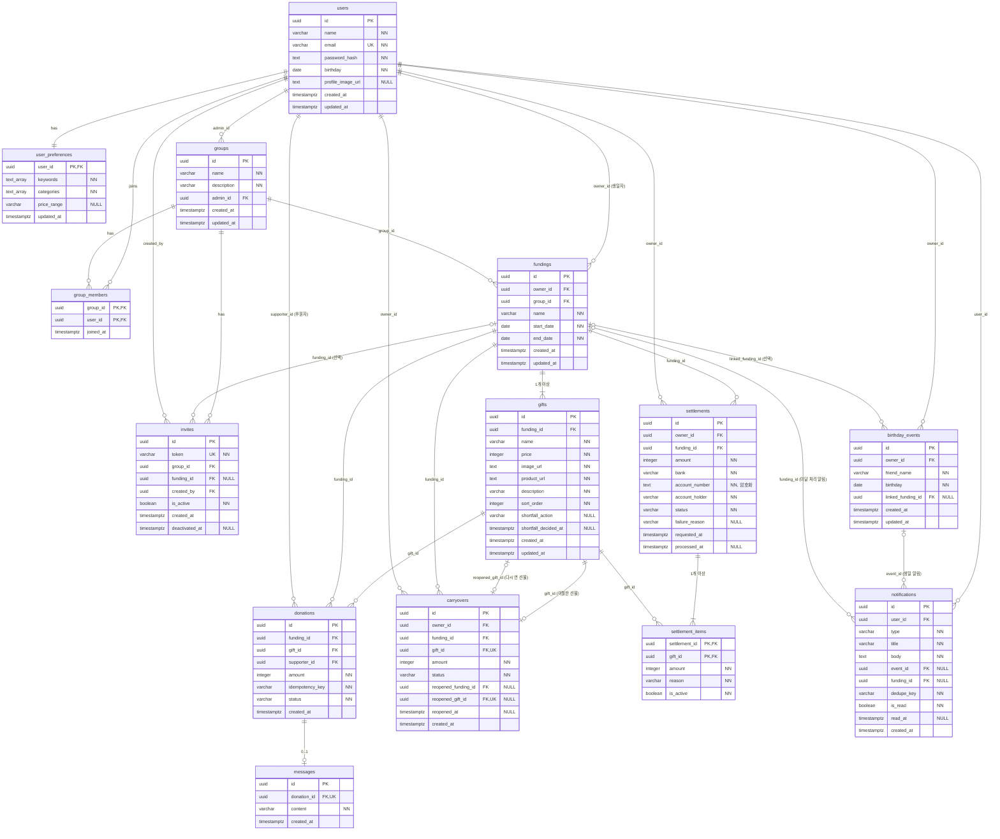

# ERD.md — 데이터베이스 구조 (Entity · Attribute · Relationship)

> 작성일: 2026-10-19 · 상태: **설계 문서 (DB 미구축)** · DBMS: PostgreSQL (TechStack)
> 근거
> - 저장할 데이터: `docs/backend/API.SPEC.md`, `docs/API_SPEC.md`의 요청 · 응답
> - Entity 간 관계: `docs/product/FEATURE_SPEC.md` (F-01 ~ F-16, 4장 공통 규칙)
> - 확정 정책: `docs/DATA_MODEL.md` 6장, `docs/business-logic/99-open-questions.md` 13.0 (2026-10-19 결정 포함)
>
> 이 문서는 DB 구조만 모은 것이다. 새 정책은 정하지 않았다. 미정 값은 ❓로 표시한다.
>
> 변경 이력
> - 2026-10-19 검토 반영: 알림 종류별 CHECK · 정산 항목 `is_active` + 부분 UNIQUE 인덱스 · 이월 상태 CHECK · 펀딩 기간 21일 CHECK · 글자 수 확정(Q1 · Q4)

---

## 0. 표기 · 공통 규칙

| 표기 | 뜻 |
|---|---|
| PK | 기본 키 |
| FK | 외래 키 (→ 참조 테이블.컬럼) |
| UK | UNIQUE |
| NN | NOT NULL |
| NULL | 비어 있을 수 있음 |

- ID: `UUID` (서버가 생성)
- 금액: `INTEGER` (원 단위 정수, 1원 단위)
- 날짜만: `DATE` · 시각: `TIMESTAMPTZ` (기준 시간대 Asia/Seoul)
- 모든 테이블에 `created_at TIMESTAMPTZ NN DEFAULT now()`를 둔다 (`group_members`는 `joined_at`).
- 삭제는 Hard Delete다 (복구 기능 없음).
- **글자 수 (📌 2026-10-19 확정, Q1 · Q4)**: 화면 입력 제한 = 서버 검증 = DB 컬럼 길이. 넘으면 서버가 `400 VALIDATION` "OO은 N자 이내로 입력해 주세요."

  | 항목 | 컬럼 | 최대 |
  |---|---|---|
  | 사용자 이름 | `users.name` | 50 |
  | 이메일 | `users.email` | 255 |
  | 그룹 이름 · 설명 | `groups.name` · `groups.description` | 30 · 100 |
  | 펀딩 이름 | `fundings.name` | 40 |
  | 선물 이름 · 설명 | `gifts.name` · `gifts.description` | 100 · 100 |
  | 친구 이름 | `birthday_events.friend_name` | 20 |
  | 축하 메시지 | `messages.content` | 200 |
- **저장하지 않는 값**: 선물 모금액 · 남은 금액 · 달성률 · 후원 마감, 펀딩 상태 · 총 모금액, 초대 링크 만료, 정산 상태 표시 — 조회할 때 서버가 계산한다 (6장).

---

## 1. Entity 목록

| # | Entity (테이블) | 한 행의 뜻 | 관련 기능 |
|---|---|---|---|
| 1 | `users` | 회원 1명 | F-01, F-02 |
| 2 | `user_preferences` | 회원 1명의 선물 취향 | F-02, F-03 |
| 3 | `groups` | 비공개 그룹 1개 | F-05 |
| 4 | `group_members` | 그룹 참여 1건 (그룹 ↔ 회원) | F-05, F-06 |
| 5 | `invites` | 초대 링크 1개 | F-06 |
| 6 | `fundings` | 생일 펀딩 1개 | F-07 |
| 7 | `gifts` | 펀딩에 올린 선물 1개 | F-04, F-09, F-11 |
| 8 | `donations` | 후원 1건 | F-08, F-10 |
| 9 | `messages` | 후원에 붙은 축하 메시지 1개 | F-14 |
| 10 | `carryovers` | 미달 선물의 이월 기록 1건 | F-11 |
| 11 | `settlements` | 정산 요청 1건 | F-12 |
| 12 | `settlement_items` | 정산에 포함된 선물 1개 (정산 ↔ 선물) | F-12 |
| 13 | `birthday_events` | 친구 생일 일정 1개 | F-15 |
| 14 | `notifications` | 알림 1개 | F-16 |

---

## 2. ERD



---

## 3. Entity별 Attribute

### 3.1 사용자

**users** — 회원 (F-01, F-02)

| Attribute | Type | 제약 · 기본값 | 설명 |
|---|---|---|---|
| id | UUID | PK | |
| name | VARCHAR(50) | NN | 실명. 축하 메시지 작성자 이름으로 쓴다 (F-14) · 📌 최대 50자 |
| email | VARCHAR(255) | NN, **UK** | 소문자로 저장 → 중복 가입 방지 (F-01) · 📌 최대 255자 |
| password_hash | TEXT | NN | Argon2 해시. 원문 · 확인값은 저장하지 않음 |
| birthday | DATE | NN | 오늘 이후 불가 (서버 검증) |
| profile_image_url | TEXT | NULL | 📌 JPG · PNG · WEBP · GIF, 5MB. 지금은 data URL 문자열, 배포 전 파일 저장소 URL로 변경 (Q2) |
| created_at / updated_at | TIMESTAMPTZ | NN, now() | |

**user_preferences** — 선물 취향 (F-02, F-03)

| Attribute | Type | 제약 · 기본값 | 설명 |
|---|---|---|---|
| user_id | UUID | **PK**, FK → users.id | 사용자당 1행 |
| keywords | TEXT[] | NN, 기본 `{}` | 공백 · 중복 제거, 최대 10개 (📌 Q3) |
| categories | TEXT[] | NN, 기본 `{}` | 정해진 카테고리 값만 |
| price_range | VARCHAR(20) | NULL, CHECK(`under30k` · `30k-100k` · `100k-300k` · `300k-500k` · `over500k`) | |
| updated_at | TIMESTAMPTZ | NN, now() | |

### 3.2 그룹 · 초대

**groups** — 비공개 그룹 (F-05)

| Attribute | Type | 제약 · 기본값 | 설명 |
|---|---|---|---|
| id | UUID | PK | |
| name | VARCHAR(30) | NN | 펀딩 이름과 별도 · 📌 최대 30자 |
| description | VARCHAR(100) | NN, 기본 `''` | 선택 입력 · 📌 최대 100자 |
| admin_id | UUID | NN, FK → users.id | 그룹을 만든 사람 = 관리자 |
| created_at / updated_at | TIMESTAMPTZ | NN, now() | |

> 그룹 삭제 기능은 없다 (F-05).

**group_members** — 그룹 참여 (F-05, F-06)

| Attribute | Type | 제약 · 기본값 | 설명 |
|---|---|---|---|
| group_id | UUID | **PK(1)**, FK → groups.id | |
| user_id | UUID | **PK(2)**, FK → users.id | 복합 PK → 중복 참여 방지 (F-06) |
| joined_at | TIMESTAMPTZ | NN, now() | |

> 관리자도 한 행으로 들어간다. 관리자 여부는 `groups.admin_id`로 판단한다.

**invites** — 초대 링크 (F-06)

| Attribute | Type | 제약 · 기본값 | 설명 |
|---|---|---|---|
| id | UUID | PK | |
| token | VARCHAR(64) | NN, **UK** | Python `secrets`로 생성 (예측 불가) |
| group_id | UUID | NN, FK → groups.id | |
| funding_id | UUID | NULL, FK → fundings.id **ON DELETE CASCADE** | NULL = 그룹 링크, 값 = 펀딩 지정 링크 |
| created_by | UUID | NN, FK → users.id | 그룹 관리자 또는 펀딩 생일자 |
| is_active | BOOLEAN | NN, 기본 true | 삭제 대신 비활성화 |
| created_at | TIMESTAMPTZ | NN, now() | |
| deactivated_at | TIMESTAMPTZ | NULL | |

> 만료는 저장하지 않는다: `funding_id`가 있고 그 펀딩이 종료되면 만료 (F-06).

### 3.3 펀딩 · 선물

**fundings** — 생일 펀딩 (F-07)

| Attribute | Type | 제약 · 기본값 | 설명 |
|---|---|---|---|
| id | UUID | PK | |
| owner_id | UUID | NN, FK → users.id | 펀딩을 만든 사람 = 생일자 |
| group_id | UUID | NN, FK → groups.id | 📌 생일자가 **만든** 그룹 (`groups.admin_id = owner_id`, 서버 검증 · 2026-10-19 확정). 생성 후 변경 불가 |
| name | VARCHAR(40) | NN | 종료 전까지 변경 가능 · 📌 최대 40자 |
| start_date | DATE | NN | 오늘 포함 이후 (서버 검증), 생성 후 변경 불가 |
| end_date | DATE | NN, CHECK(아래) | 시작일 포함 최대 21일, 생성 후 변경 불가 |
| created_at / updated_at | TIMESTAMPTZ | NN, now() | |

```sql
-- fundings 기간: 종료일 ≥ 시작일, 시작일 포함 최대 21일 (DATE + 정수 = DATE)
CHECK (end_date >= start_date AND end_date <= start_date + 20)
```

> "시작일은 오늘 포함 이후"는 기준 날짜(오늘)가 매일 바뀌어 DB CHECK로 걸 수 없다 → **서버 검증**으로 막는다 (생성 시에만 확인).
>
> "펀딩은 그 그룹을 만든 사람만 연다"(`fundings.owner_id = groups.admin_id`)는 다른 테이블 값을 봐야 해서 CHECK로 걸 수 없다 → **서버 검증** (F3에서 403).

**gifts** — 펀딩 선물 (F-04, F-09, F-11)

| Attribute | Type | 제약 · 기본값 | 설명 |
|---|---|---|---|
| id | UUID | PK | |
| funding_id | UUID | NN, FK → fundings.id **ON DELETE CASCADE** | |
| name | VARCHAR(100) | NN | 📌 최대 100자 |
| price | INTEGER | NN, CHECK(`price > 0`) | 실제 가격 = 목표 금액 |
| image_url | TEXT | NN | |
| product_url | TEXT | NN | URL 형식 (서버 검증) |
| description | VARCHAR(100) | NN, 기본 `''` | 선택 입력 · 📌 최대 100자 |
| sort_order | INTEGER | NN | 등록 순서 |
| shortfall_action | VARCHAR(10) | NULL, CHECK(`carryover` · `withdraw`) | 목표 미달 처리 결과. 한 번 정하면 변경 불가. 0원 선물은 NULL 그대로 |
| shortfall_decided_at | TIMESTAMPTZ | NULL | |
| created_at / updated_at | TIMESTAMPTZ | NN, now() | |

### 3.4 후원 · 메시지

**donations** — 후원 (F-08, F-10)

| Attribute | Type | 제약 · 기본값 | 설명 |
|---|---|---|---|
| id | UUID | PK | |
| funding_id | UUID | NN, FK → fundings.id **ON DELETE RESTRICT** | 조회용 (= 선물의 펀딩) |
| gift_id | UUID | NN, FK → gifts.id **ON DELETE RESTRICT** | 후원이 있는 선물 · 펀딩은 삭제 불가 |
| supporter_id | UUID | NN, FK → users.id | 후원자 |
| amount | INTEGER | NN, CHECK(`amount > 0`) | 1원 단위 |
| idempotency_key | VARCHAR(64) | NN | `(supporter_id, idempotency_key)` **UK** → 같은 요청 중복 방지 |
| status | VARCHAR(20) | NN, 기본 `completed` | 모의 후원이라 현재 값은 `completed` 하나 |
| created_at | TIMESTAMPTZ | NN, now() | |

**messages** — 축하 메시지 (F-14)

| Attribute | Type | 제약 · 기본값 | 설명 |
|---|---|---|---|
| id | UUID | PK | |
| donation_id | UUID | NN, **UK**, FK → donations.id | 후원 1건당 최대 1개 |
| content | VARCHAR(200) | NN | 빈 메시지는 행을 만들지 않음 · 📌 최대 200자 |
| created_at | TIMESTAMPTZ | NN, now() | |

> 작성자 · 펀딩 · 선물은 `donations`로 찾는다. 후원과 같은 트랜잭션으로 저장한다.

### 3.5 목표 미달 · 정산

**carryovers** — 다음 생일로 이월 (F-11)

| Attribute | Type | 제약 · 기본값 | 설명 |
|---|---|---|---|
| id | UUID | PK | |
| owner_id | UUID | NN, FK → users.id | 생일자 |
| funding_id | UUID | NN, FK → fundings.id | 이월한 펀딩 |
| gift_id | UUID | NN, **UK**, FK → gifts.id | 이월한 선물 (같은 선물 중복 이월 방지) |
| amount | INTEGER | NN, CHECK(`amount > 0`) | 이월 금액 |
| status | VARCHAR(20) | NN, CHECK(`pending` · `reopened`), 기본 `pending` | 다음 생일 대기 / 다시 연 펀딩에 반영 |
| reopened_funding_id | UUID | NULL, FK → fundings.id | 다시 연 펀딩 |
| reopened_gift_id | UUID | NULL, **UK**, FK → gifts.id | 이월 금액이 시작 모금액으로 들어간 선물 |
| reopened_at | TIMESTAMPTZ | NULL | |
| created_at | TIMESTAMPTZ | NN, now() | |

```sql
-- carryovers 상태 값과 "다시 연" 정보의 짝을 맞춘다
CHECK (status IN ('pending', 'reopened'))
CHECK (
  (status = 'pending'  AND reopened_funding_id IS NULL     AND reopened_gift_id IS NULL     AND reopened_at IS NULL)
  OR
  (status = 'reopened' AND reopened_funding_id IS NOT NULL AND reopened_gift_id IS NOT NULL AND reopened_at IS NOT NULL)
)
```

**settlements** — 정산 요청 (F-12)

| Attribute | Type | 제약 · 기본값 | 설명 |
|---|---|---|---|
| id | UUID | PK | |
| owner_id | UUID | NN, FK → users.id | 생일자 |
| funding_id | UUID | NN, FK → fundings.id | |
| amount | INTEGER | NN, CHECK(`amount > 0`) | 정산 항목 합계 (서버 계산) |
| bank | VARCHAR(30) | NN | 📌 9개 은행 중 하나 (서버 검증, Q10) |
| account_number | TEXT | NN | **암호화 저장** — 📌 Fernet 암호문(Base64 문자열, 열쇠 `ACCOUNT_ENCRYPTION_KEY`, 2026-10-19 확정)이라 길이가 정해지지 않은 TEXT. `-`를 뺀 숫자를 암호화한다. 응답은 마스킹(뒤 4자리) |
| account_holder | VARCHAR(50) | NN | 본인 명의 — 회원 이름과 문자열 비교 (📌 Q10) |
| status | VARCHAR(20) | NN, CHECK(`requested` · `processing` · `completed` · `failed`) | 프로그램이 자동 변경 |
| failure_reason | VARCHAR(30) | NULL, CHECK(`ACCOUNT_INVALID` · `BANK_ERROR`) | 실패 이유 |
| requested_at | TIMESTAMPTZ | NN, now() | |
| processed_at | TIMESTAMPTZ | NULL | 완료 · 실패 시각 |

**settlement_items** — 정산에 포함된 선물 (F-12)

| Attribute | Type | 제약 · 기본값 | 설명 |
|---|---|---|---|
| settlement_id | UUID | **PK(1)**, FK → settlements.id | |
| gift_id | UUID | **PK(2)**, FK → gifts.id | |
| amount | INTEGER | NN | 요청 시점의 선물 모금액 |
| reason | VARCHAR(10) | NN, CHECK(`achieved` · `withdraw`) | 목표 달성 / 미달 인출 |
| is_active | BOOLEAN | NN, 기본 true | 유효한 정산 항목인지. 정산이 `failed`가 되면 **같은 트랜잭션에서** 그 정산의 항목을 모두 false로 바꾼다 (2026-10-19 확정) |

> 중복 정산 방지: `requested` · `processing` · `completed` 정산에 같은 선물이 두 번 들어갈 수 없다 (`failed`만 재요청 가능). 서버 검증(선물 행 잠금) + 아래 부분 UNIQUE 인덱스로 보장한다. `is_active`는 실패할 때 한 번만 바뀌어서, 정산 상태가 바뀔 때마다 항목을 고칠 필요가 없다.

```sql
-- 유효한(실패하지 않은) 정산 항목에서 같은 선물은 한 번만
CREATE UNIQUE INDEX uq_settlement_items_active_gift
  ON settlement_items (gift_id) WHERE is_active;
```

### 3.6 생일 캘린더 · 알림

**birthday_events** — 친구 생일 일정 (F-15)

| Attribute | Type | 제약 · 기본값 | 설명 |
|---|---|---|---|
| id | UUID | PK | |
| owner_id | UUID | NN, FK → users.id | 본인 일정만 관리 |
| friend_name | VARCHAR(20) | NN | 📌 최대 20자 |
| birthday | DATE | NN | 매년 반복 표시 |
| linked_funding_id | UUID | NULL, FK → fundings.id **ON DELETE SET NULL** | 열람 권한이 있는 펀딩만 연결 (서버 검증) |
| created_at / updated_at | TIMESTAMPTZ | NN, now() | |

**notifications** — 알림 (F-16)

| Attribute | Type | 제약 · 기본값 | 설명 |
|---|---|---|---|
| id | UUID | PK | |
| user_id | UUID | NN, FK → users.id | 받는 사람 |
| type | VARCHAR(20) | NN, CHECK(`birthday-before` · `birthday-today` · `shortfall-reminder`) | 생일 하루 전 / 당일 / 미달 처리 알림 |
| title | VARCHAR(100) | NN | 권한 없는 펀딩의 비공개 정보는 넣지 않음 |
| body | TEXT | NN | |
| event_id | UUID | NULL, FK → birthday_events.id **ON DELETE CASCADE** | 생일 알림만 채움 |
| funding_id | UUID | NULL, FK → fundings.id **ON DELETE CASCADE** | **미달 처리 알림만** 채움. 생일 알림은 항상 NULL (일정의 현재 연결 펀딩으로 판단) |
| dedupe_key | VARCHAR(100) | NN | `(user_id, dedupe_key)` **UK** → 같은 알림 중복 방지 |
| is_read | BOOLEAN | NN, 기본 false | |
| read_at | TIMESTAMPTZ | NULL | |
| created_at | TIMESTAMPTZ | NN, now() | |

```sql
-- 알림 종류별로 연결 대상을 하나만 갖는다 (2026-10-19 확정)
CHECK (
  (type IN ('birthday-before', 'birthday-today') AND event_id IS NOT NULL AND funding_id IS NULL)
  OR
  (type = 'shortfall-reminder' AND funding_id IS NOT NULL AND event_id IS NULL)
)
```

> - 생일 알림: 일정(`event_id`)에만 연결. 펀딩은 저장하지 않고 조회할 때 일정의 현재 연결 펀딩으로 판단 → 펀딩이 지워져도 영향 없음. 일정을 지우면 함께 삭제.
> - 미달 처리 알림: 펀딩(`funding_id`)에만 연결 → 펀딩을 지우면 함께 삭제.

---

## 4. Relationship

| # | 관계 (부모 → 자식) | 카디널리티 | 연결 컬럼 (FK) | 부모 삭제 시 | 근거 (FEATURE_SPEC) |
|---|---|---|---|---|---|
| R1 | users → user_preferences | 1 : 1 | `user_preferences.user_id` | — (회원 삭제 기능 없음) | F-02 취향은 사용자별로 저장 |
| R2 | users ↔ groups | **N : M** (`group_members`) | `group_members.user_id`, `group_members.group_id` | — | 4.1 한 사용자는 여러 그룹에 참여 · F-06 중복 참여 방지 |
| R3 | users → groups (관리자) | 1 : N | `groups.admin_id` | — | F-05 그룹을 만든 사람이 관리자 · 4.1 관리자와 생일자 권한 구분 |
| R4 | groups → invites | 1 : N | `invites.group_id` | — (그룹 삭제 없음) | F-06 그룹 초대 링크 |
| R5 | fundings → invites | 1 : N (선택) | `invites.funding_id` NULL 가능 | **CASCADE** | F-06 펀딩 초대 링크 · F-07 펀딩 삭제 시 전용 링크 삭제 |
| R6 | users → invites (만든 사람) | 1 : N | `invites.created_by` | — | F-06 관리 권한자만 링크 관리 |
| R7 | users → fundings (생일자) | 1 : N | `fundings.owner_id` | — | 4.1 자신의 펀딩 생성 · 펀딩마다 생일자 / 후원자 역할 |
| R8 | groups → fundings | 1 : N | `fundings.group_id` | — | F-07 펀딩은 접근 권한이 있는 그룹에 연결 · 그룹 변경 불가 · 4.2 그룹 참여자만 열람 |
| R9 | fundings → gifts | 1 : N (**최소 1**) | `gifts.funding_id` | **CASCADE** | F-04 펀딩별 여러 선물 · F-07 선물 최소 1개 |
| R10 | gifts → donations | 1 : N | `donations.gift_id` | **RESTRICT** | F-08 선물 선택 후 후원 · 4.5 같은 선물에 여러 번 후원 허용 · F-04 후원 있는 선물 삭제 제한 |
| R11 | fundings → donations | 1 : N | `donations.funding_id` | **RESTRICT** | F-07 후원 있는 펀딩 삭제 불가 |
| R12 | users → donations (후원자) | 1 : N | `donations.supporter_id` | — | 4.1 다른 사람 펀딩에 후원 · F-13 본인 후원 내역 |
| R13 | donations → messages | 1 : 0..1 | `messages.donation_id` (UK) | — (후원 삭제 없음) | F-14 후원할 때 메시지 선택 작성 · 4.5 후원과 메시지 일관성 |
| R14 | gifts → carryovers (이월한 선물) | 1 : 0..1 | `carryovers.gift_id` (UK) | — | F-11 미달 선물은 이월 또는 인출 중 하나 · 중복 사용 불가 |
| R15 | gifts → carryovers (다시 연 선물) | 0..1 : 0..1 | `carryovers.reopened_gift_id` (UK) | — | F-07 이월 선물을 다시 열면 이월 금액이 시작 모금액 |
| R16 | fundings → carryovers | 1 : N | `carryovers.funding_id`, `reopened_funding_id` | — | F-11 이월 · F-07 다시 연 펀딩 삭제 불가 |
| R17 | users → carryovers | 1 : N | `carryovers.owner_id` | — | F-07 본인 이월 선물만 불러오기 |
| R18 | fundings → settlements | 1 : N | `settlements.funding_id` | — | F-12 종료된 펀딩의 정산 요청 · 실패 시 재요청 |
| R19 | users → settlements | 1 : N | `settlements.owner_id` | — | F-12 생일자만 정산 · 본인 명의 계좌 |
| R20 | settlements ↔ gifts | N : M (`settlement_items`) | `settlement_items.settlement_id`, `gift_id` | — | F-12 정산할 선물 선택 · 선물별 중복 정산 방지 |
| R21 | users → birthday_events | 1 : N | `birthday_events.owner_id` | — | F-15 본인이 친구 생일 등록 · 수정 · 삭제 |
| R22 | fundings → birthday_events | 1 : N (선택) | `birthday_events.linked_funding_id` | **SET NULL** | F-15 펀딩 연결(선택) · F-07 펀딩 삭제 시 연결 해제 |
| R23 | users → notifications | 1 : N | `notifications.user_id` | — | F-16 본인 알림 |
| R24 | birthday_events → notifications | 1 : N (선택) | `notifications.event_id` | **CASCADE** | F-16 하루 전 · 당일 알림 · F-15 일정 삭제 시 알림 삭제 |
| R25 | fundings → notifications | 1 : N (선택) | `notifications.funding_id` (미달 처리 알림만) | **CASCADE** | F-11 7일 경과 미달 알림 · F-07 펀딩 삭제 시 미달 알림 삭제. SET NULL을 쓰지 않는 이유: 펀딩 없는 미달 알림은 남길 의미가 없다. 생일 알림은 `funding_id`가 없어(CHECK) 영향받지 않는다 |

### 4.1 관계로 정해지는 권한 (저장하지 않음)

| 역할 | 판단 기준 |
|---|---|
| 생일자 | `fundings.owner_id = 나` |
| 후원자 | `group_members`에 (`fundings.group_id`, 나)가 있고 생일자가 아님 |
| 그룹 관리자 | `groups.admin_id = 나` — 그룹 이름 · 설명 수정, 그 그룹에 펀딩 열기 (2026-10-19 확정) |
| 그룹 참여자 | `group_members`에 (그룹, 나)가 있음 |
| 일정 주인 | `birthday_events.owner_id = 나` |

---

## 5. 제약 · 인덱스

| 종류 | 위치 | 막는 것 |
|---|---|---|
| UK | `users.email` | 중복 가입 |
| 복합 PK | `group_members (group_id, user_id)` | 중복 참여 |
| UK | `invites.token` | 같은 토큰 |
| UK | `donations (supporter_id, idempotency_key)` | 같은 후원 요청 중복 저장 |
| UK | `messages.donation_id` | 후원 1건에 메시지 여러 개 |
| UK | `carryovers.gift_id`, `carryovers.reopened_gift_id` | 이중 이월 · 이월 금액 이중 반영 |
| 복합 PK | `settlement_items (settlement_id, gift_id)` | 한 정산에 같은 선물 두 번 |
| 부분 UK | `uq_settlement_items_active_gift`: `settlement_items(gift_id) WHERE is_active` | 같은 선물 이중 정산 (실패 후 재요청은 허용) |
| UK | `notifications (user_id, dedupe_key)` | 같은 알림 중복 생성 |
| CHECK | `fundings`: `end_date >= start_date AND end_date <= start_date + 20` | 거꾸로 된 기간 · 21일 초과 |
| CHECK | `carryovers`: 상태 값 + `reopened`일 때만 다시 연 정보 | 상태와 데이터 불일치 |
| CHECK | `notifications`: 알림 종류별 `event_id` / `funding_id` 하나만 | 연결 대상 없는 알림 · 잘못된 연결 |
| CHECK | 금액 `> 0`, 상태 · 유형 값 목록 | 잘못된 값 |
| 길이 | VARCHAR 길이 = 확정 글자 수 (0장) | 너무 긴 값 |
| FK RESTRICT | `donations.gift_id`, `donations.funding_id` | 후원이 있는 선물 · 펀딩 삭제 |

조회용 인덱스 (권장): `fundings(owner_id)`, `fundings(group_id)`, `gifts(funding_id)`, `donations(gift_id)`, `donations(supporter_id)`, `invites(group_id)`, `birthday_events(owner_id)`, `notifications(user_id, is_read)`

---

## 6. 저장하지 않고 계산하는 값

| 값 | 계산 (원천 데이터) |
|---|---|
| 선물 모금액 | `donations.amount` 합계(그 선물) + `carryovers.amount`(`reopened_gift_id` = 그 선물) |
| 남은 금액 · 달성률 · 후원 마감 | 모금액과 `gifts.price` — 달성률 최대 100% |
| 펀딩 상태 (예정 · 진행 중 · 종료) | `fundings.start_date` · `end_date`와 오늘(Asia/Seoul) |
| 펀딩 총 모금액 | 그 펀딩 선물들의 모금액 합 (생일자에게만) |
| 초대 링크 만료 | `invites.funding_id` → 그 펀딩이 종료됐는지 |
| 선물 정산 상태 ("정산됨") | `settlement_items` → `settlements.status` (실패 제외) |
| 미달 처리 기한 | `fundings.end_date` + 7일 |

---

## 7. 삭제 시 데이터 처리

| 지우는 것 | 삭제 조건 (서버 검증) | 함께 삭제 | 연결만 해제 |
|---|---|---|---|
| 펀딩 | 생일자 · 후원 0건 · 이월 금액이 들어간 선물 없음 | 선물, 지정 초대 링크, 미달 처리 알림 | 생일 일정 `linked_funding_id` → NULL |
| 선물 | 생일자 · 후원 0건 · 이월 금액 없음 · 선물 2개 이상 | — | — |
| 생일 일정 | 일정 주인 | 그 일정의 알림 | — |

삭제 기능이 없는 테이블: `users`, `groups`, `group_members`, `invites`(비활성화만), `donations`, `messages`, `carryovers`, `settlements`, `settlement_items`
