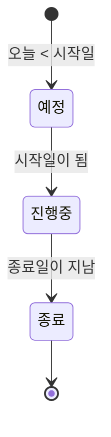
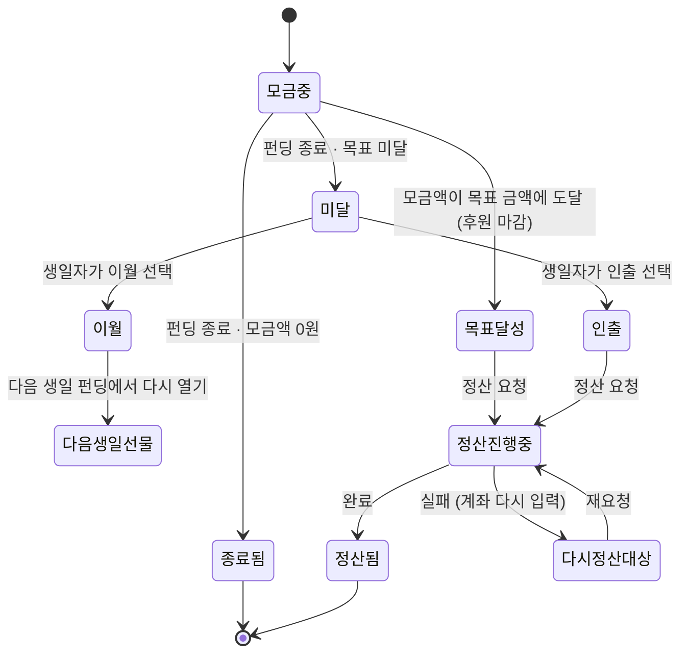

# 비즈니스 로직 요약 (규칙 · 상태 · 권한)

> 상태: **설계 문서 (코드 구현 없음)** · 작성일: 2026-10-19
> 근거: 이 폴더의 기능별 문서(2~8장), `docs/product/FEATURE_SPEC.md`
> 데이터 구조(테이블 · 관계 · 제약)는 [00-data-relations.md](./00-data-relations.md)에 따로 정리했다.
> 표시 기호(✅ 프론트 / ✅ Mock / 🔧 백엔드 / ❓ 확인 필요 / 📌 확정)는 [README](./README.md) 참고
>
> 이 문서는 기능별 문서의 **규칙만 한눈에 모은 요약**이다. 검증 문구 · 오류 코드 · 입력/결과 형식은 각 장을 본다.
> 새 정책을 정하지 않는다.

---

## 1. 서비스 흐름 한 줄 요약

1. 회원가입 · 로그인 후 선물 취향을 저장한다.
2. 그룹을 만들거나 **초대 링크로** 그룹에 참여한다.
3. 생일자가 그룹 하나에 연결한 **펀딩**을 만들고 **선물**을 올린다.
4. 그 그룹 참여자가 선물에 **후원**하고 축하 메시지를 남긴다.
5. 펀딩이 끝나면 선물마다 **목표 달성 → 정산**, 또는 **미달 → 이월 / 인출(→ 정산)** 로 마무리한다.
6. 생일 캘린더와 알림이 친구 생일과 펀딩을 챙겨 준다.

---

## 2. 도메인별 핵심 규칙

### 2.1 사용자 관리 (2장)

- 이메일은 한 계정만 쓸 수 있다. 비밀번호는 원문으로 저장하지 않는다.
- 이름은 실명이며, 축하 메시지 작성자 이름으로 그대로 쓰인다.
- 선물 취향(관심사 · 카테고리 · 가격대)은 사용자마다 하나이고, AI 추천의 기본 조건이 된다.
- 로그인 토큰은 30일 유효하다. "로그인 상태 유지"를 고르면 브라우저를 닫아도 유지된다 (📌 Q16).

### 2.2 그룹 · 초대 (3장)

- 그룹을 만든 사람이 관리자다. 관리자도 참여자 중 한 명이다.
- 그룹에는 **초대 링크로만** 들어온다. 같은 그룹에 두 번 들어갈 수 없다 (이미 참여 중이면 바로 이동).
- 📌 초대받아 참여한 **그 그룹의 펀딩만** 보고 후원할 수 있다.
- 초대 링크는 그룹 전체용과 펀딩 지정용이 있다. 펀딩 지정 링크로 들어오면 그 펀딩으로 바로 간다. 📌 그룹 링크로 들어오면 진행 중인 친구 펀딩(시작일 최신)으로, 없으면 그룹 상세로 간다.
- 📌 펀딩 지정 링크는 **펀딩이 끝나면 만료**된다. 링크는 지울 수 없고 비활성화만 할 수 있다.
- 그룹은 지울 수 없다. 📌 그룹 이름 · 설명은 **만든 사람만** 수정한다 (Q9).
- 📌 펀딩은 **그 그룹을 만든 사람만** 열 수 있다. 내 생일 펀딩은 내가 만든 그룹에 연다 (그룹 여러 개 가능, 그룹마다 펀딩 가능).

### 2.3 선물 · AI 추천 (4장)

- 선물은 이름 · 가격(= 목표 금액) · 이미지 · 구매 링크가 필수, 설명은 선택이다.
- 📌 선물은 펀딩이 **끝나기 전까지**(예정 · 진행 중) 계속 추가할 수 있다.
- 후원이 들어온 선물은 **가격을 바꾸거나 지울 수 없다.** 펀딩의 마지막 선물 하나도 지울 수 없다.
- AI 추천은 참고용이다. 자동으로 등록되지 않고, "선물로 등록"하면 이름만 채워 등록 화면으로 간다.
- AI는 서버가 OpenAI API로 호출한다. 키는 화면에 노출하지 않는다 (모델 · 시간 초과 · 개수 · 횟수 제한 ❓ Q21~Q24).

### 2.4 펀딩 (5장)

- 펀딩을 만든 사람이 생일자다. 펀딩은 **만든 사람이 참여 중인 그룹 하나**에 연결된다.
- 📌 시작일은 **오늘 포함** 이후(과거 불가, 오늘이면 바로 진행 중), 기간은 **최대 3주**(시작일 포함 21일).
- 📌 펀딩 이름은 끝나기 전까지 바꿀 수 있다. **기간 · 연결 그룹은 만든 뒤 바꿀 수 없다.** 진행 중에도 그룹에 사람을 초대할 수 있다.
- 선물마다 목표 금액 · 달성률을 따로 본다. 펀딩 전체 목표를 합산하지 않는다.
- 생일자에게만 모금액 · 남은 금액 · 후원자 · 메시지가 보인다. 후원자에게는 **달성률만** 보인다 (서버 응답에서 뺀다).
- 📌 지난 생일에 이월한 선물을 다음 생일 펀딩에서 **다시 열 수 있다.** 이월 금액이 시작 모금액이 된다. 📌 목표를 달성할 때까지 몇 번이든 다시 이월할 수 있다.

### 2.5 후원 · 축하 메시지 (6장)

- **진행 중인 펀딩**의, **목표를 아직 못 채운 선물**에만 후원할 수 있다.
- 📌 금액은 1원 단위, 최소 1원, 최대는 남은 금액이다. 넘으면 "최대 얼마까지 가능"을 알려준다.
- 📌 생일자는 자기 펀딩에 후원할 수 없다. 후원자는 펀딩이 연결된 그룹의 참여자여야 한다.
- 같은 사람이 같은 선물에 여러 번 후원할 수 있다. 다만 **같은 요청이 두 번 전송돼도 한 번만** 처리하고, 재전송에는 그 사이 마감 · 종료됐더라도 처음 성공 결과를 돌려준다.
- 여러 사람이 동시에 후원해도 목표 금액을 넘지 않아야 한다.
- 축하 메시지는 선택(📌 최대 200자)이다. 생일자만 읽는다. 후원과 메시지는 같이 저장되거나 같이 실패한다.
- 실제 결제는 없는 모의 후원이다. 후원 취소 · 환불은 이번 범위에서 제외한다 (📌 Q19).

### 2.6 목표 미달 · 이월 · 정산 (7장)

- 목표를 달성한 선물은 정산 대상이다.
- 미달 선물(모금액 > 0)은 생일자가 **다음 생일로 이월** 또는 **현재 모금액 인출** 중 하나를 고른다. 고른 뒤에는 바꿀 수 없다. 같은 돈을 이월과 인출에 중복으로 쓸 수 없다.
- 📌 모금액 0원인 미달 선물은 처리 없이 **"종료됨"**으로 끝난다. 상태 값을 따로 저장하지 않고, 미달 처리 · 정산 · 7일 알림 대상에서 계산으로 뺀다.
- 📌 선택 기한은 **종료 후 7일**. 지나도 고르지 않았으면 생일자에게 알림을 **한 번** 보낸다. 그 뒤에도 고를 수 있다.
- 정산 대상 = 목표 달성 선물 + 인출 선택 선물 (이월 선물 · 이미 요청 / 처리 중 / 완료된 선물 제외, 실패한 선물은 다시 가능). 금액은 서버가 계산한다.
- 정산 은행은 9개 중 선택, 계좌번호는 숫자 10~14자리, 예금주는 회원 이름과 같아야 한다 (📌 Q10).
- 📌 정산 상태는 프로그램이 자동으로 바꾼다: 요청 → 처리 중 → 완료 / 실패.
- 📌 실패하면 이유(계좌 정보 오류 / 은행 오류)를 보여주고, 계좌를 다시 입력해 재요청할 수 있다.
- 📌 정산이 끝나면 종료된 펀딩 화면에 **"정산됨"**을 표시한다.
- 실제 송금은 없는 모의 정산이다.

### 2.7 생일 캘린더 · 알림 (8장)

- 친구 이름 · 생일을 등록하고 매년 반복해 보여준다. 본인 일정만 관리한다.
- 일정에는 **볼 권한이 있는 펀딩만** 연결할 수 있다. 권한이 없으면 펀딩 이름조차 보여주지 않는다.
- 생일 **하루 전 · 당일**에 서비스 안 알림을 만든다. 같은 알림은 한 번만 만든다. 지금은 알림을 볼 때 만들고 나중에 매일 0시에 만든다. 2월 29일생은 평년에 2월 28일 기준 (📌 Q17).
- 📌 일정을 지우면 그 일정의 알림도 지운다.
- 알림을 누르면 볼 수 있는 펀딩으로, 없으면 생일 캘린더로 이동한다. 미달 처리 알림은 목표 미달 처리 화면으로 간다.

---

## 3. 상태 흐름

### 3.1 펀딩

| 상태 | 할 수 있는 일 | 할 수 없는 일 |
|---|---|---|
| 예정 | 선물 추가 · 수정, 이름 변경, 초대 | 후원 |
| 진행 중 | 후원, 선물 추가, 이름 변경, 초대 | 기간 · 연결 그룹 변경 |
| 종료 | 결과 확인, 미달 처리, 정산 | 후원, 선물 추가, 이름 변경 (펀딩 지정 초대 링크 만료) |

상태는 사람이 바꾸지 않는다. 날짜(Asia/Seoul 기준 오늘)로 정해진다.

### 3.2 선물 한 개

화면 배지 우선순위: 정산됨 → 정산 진행 중 → 목표 달성 → 다음 생일로 이월 → 현재 모금액 인출 → 종료됨 → 목표 미달 · 처리 필요

### 3.3 정산 · 초대 링크

| 대상 | 흐름 | 누가 바꾸나 |
|---|---|---|
| 정산 | 요청 → 처리 중 → 완료 / 실패 | 📌 프로그램 자동 — 모의 정산은 요청 즉시 처리 중, 1분 뒤 완료 (Q11-1 ①) |
| 이월 | 대기 → 다시 열림 | 생일자 (다음 생일 펀딩에서 불러오기) |
| 초대 링크 | 사용 가능 → 비활성 / 만료 | 비활성은 관리자 · 생일자, 만료는 펀딩 종료 시 자동 |

---

## 4. 역할별 권한

| 역할 | 누구인가 | 할 수 있는 일 | 볼 수 없는 것 |
|---|---|---|---|
| 생일자 | 펀딩을 만든 사람 | 펀딩 · 선물 관리, 모금액 · 후원자 · 메시지 보기, 미달 처리, 정산, 펀딩 지정 초대 링크 | — |
| 후원자 | 펀딩이 연결된 그룹의 참여자 (생일자 제외) | 펀딩 보기, 후원, 내 후원 내역 | 모금액 · 남은 금액 · 다른 사람 후원 · 메시지 · 정산 |
| 그룹 관리자 | 그룹을 만든 사람 | 그룹 초대 링크 만들기 · 비활성화, 그룹 이름 · 설명 수정, 그 그룹에 펀딩 열기 | — |
| 그룹 참여자 | 초대로 들어온 사람 | 그룹 상세 · 참여자 목록(이름만) · 연결 펀딩 목록 | 다른 사람 이메일 · 생일 |
| 그 밖 | 관계없는 사용자 | 없음 (접근 거부) | 전부 |

- 같은 사람이 내 펀딩에서는 생일자, 친구 펀딩에서는 후원자다.
- 권한 판단과 비공개 정보 제외는 **서버가** 한다. 화면은 버튼을 숨기거나 잠가 안내만 한다.

---

## 5. 계산 규칙 (값을 어떻게 정하나)

| 값 | 규칙 |
|---|---|
| 선물 모금액 | 그 선물에 들어온 후원 합계 + 이 선물로 다시 연 이월 금액 |
| 남은 금액 | 목표 금액 − 모금액 (0 미만 없음) |
| 달성률 | 모금액 ÷ 목표 금액 × 100, 소수점 버림, 최대 100 |
| 후원 마감 | 달성률 100 |
| 펀딩 총 모금액 | 선물 모금액의 합 (생일자만 봄) |
| 정산 금액 | 정산 대상 선물들의 모금액 합 |
| 미달 처리 기한 | 펀딩 종료일 + 7일 |
| 생일 D-day | 오늘부터 다음 생일까지 남은 날 (화면 표시용) |

모두 저장하지 않고 볼 때마다 다시 계산한다.

---

## 6. 삭제 규칙

| 대상 | 지울 수 있는 조건 | 지우면 함께 일어나는 일 |
|---|---|---|
| 펀딩 | 생일자 본인 · 후원 0건 · 이월 금액이 들어간 선물 없음 | 선물 · 이 펀딩 초대 링크 · 이 펀딩 미달 처리 알림 삭제, 생일 일정과의 연결 해제 (생일 알림은 남고 누르면 캘린더로 이동) |
| 선물 | 생일자 본인 · 그 선물 후원 0건 · 펀딩에 선물 2개 이상 | — |
| 생일 일정 | 등록한 본인 | 이 일정의 알림 삭제 |
| 그룹 · 후원 · 메시지 · 정산 | 지울 수 없음 (기록 보호) | — |
| 초대 링크 | 지울 수 없음, 비활성화만 | — |

- 지우면 복구할 수 없다. 화면은 항상 삭제 확인 창을 먼저 띄운다.

---

## 7. 아직 정하지 않은 것

[99-open-questions.md](./99-open-questions.md) 참고 — 모든 질문 확정 (13.0 표). 비밀번호 변경(Q20-1)은 2026-10-21 추가, AI 세부(Q21~Q24)는 2026-10-20 확정.
